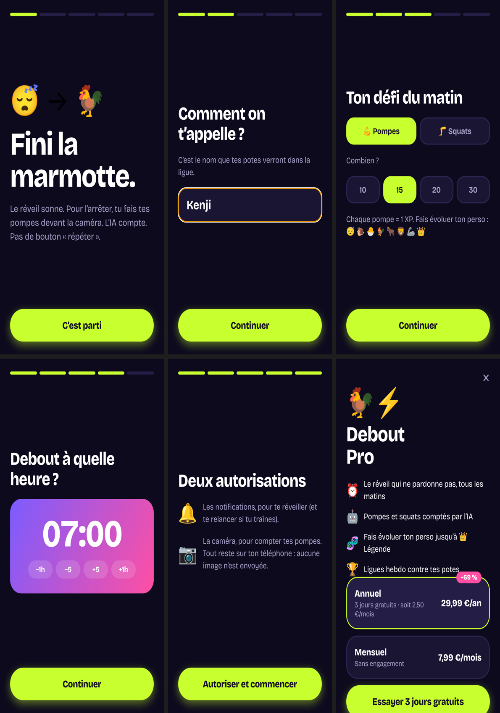
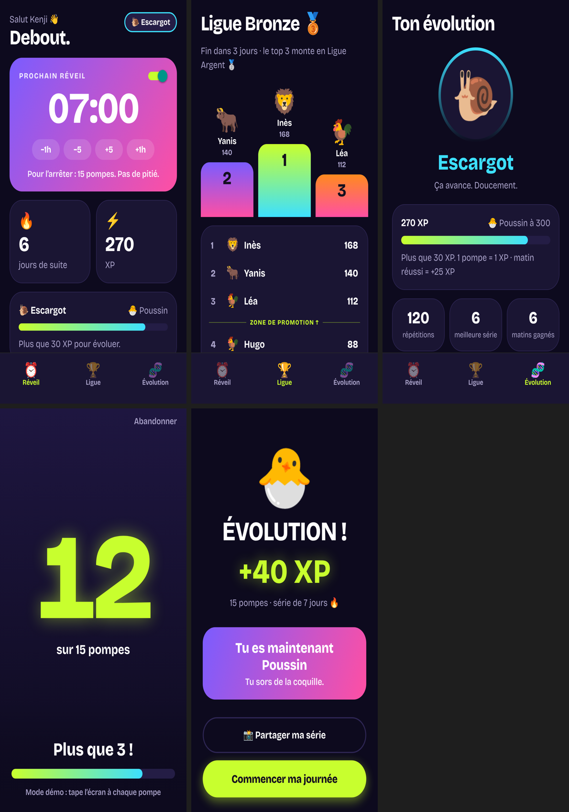

# Étape 10 — Nouvelle direction artistique + gamification

_Date : 22 octobre 2026_

La V1 faisait « vieille appli ». Refonte complète pour qu'elle soit **fun, énergique et compétitive**.

## Direction artistique

- **Ambiance :** nuit violette (`#0D0A1E`) + **vert néon** (`#C8FF2E`) pour l'action, dégradés violet → rose et orange → rose.
- **Police :** Bricolage Grotesque (titres très gras, serrés), pour un style affiche plutôt qu'appli système.
- **Boutons :** gros boutons en forme de pilule, vert néon avec un halo lumineux.
- **Ton :** tutoiement, punchlines (« Fini la marmotte. », « Pas de pitié. », « LA DERNIÈRE ! »).
- Le design system est dans `app/src/lib/theme.ts` et les composants dans `app/src/components/ui.tsx`.

## Gamification

| Mécanique | Détail |
|---|---|
| **XP** | 1 répétition = 1 XP, matin réussi = +25 XP (la régularité paie plus qu'une grosse séance) |
| **Évolution de rang** | 😴 Marmotte → 🐌 Escargot (100) → 🐣 Poussin (300) → 🐓 Coq (700) → 🐂 Taureau (1 500) → 🦁 Lion (3 000) → 🦾 Machine (6 000) → 👑 Légende (12 000) |
| **Écran « ÉVOLUTION ! »** | Quand on passe un rang, avec la phrase du nouveau rang |
| **Série 🔥** | Jours d'affilée + meilleure série |
| **Ligue hebdo** | Podium, classement de la semaine, le top 3 monte en Ligue Argent, bouton « Défier un pote » |

Navigation en 3 onglets : **Réveil**, **Ligue**, **Évolution**.

⚠️ **La ligue utilise des joueurs fictifs** (c'est indiqué sous le classement), parce qu'il faut des comptes
(Supabase) pour un vrai classement entre amis. Les noms et les scores fictifs sont dans `app/src/lib/league.ts`.

## Aperçu

Onboarding : accroche → pseudo → défi → heure → autorisations → paywall

App : accueil, ligue, évolution, défi en cours, écran d'évolution de rang (historique de 6 jours simulé pour la capture)

## Ensuite (une fois la DA validée)

1. Compte Apple Developer + premier build EAS (vraie caméra).
2. Comptes + vraie ligue entre amis (Supabase).
3. AlarmKit (vrai réveil) + RevenueCat (vrai paiement).
