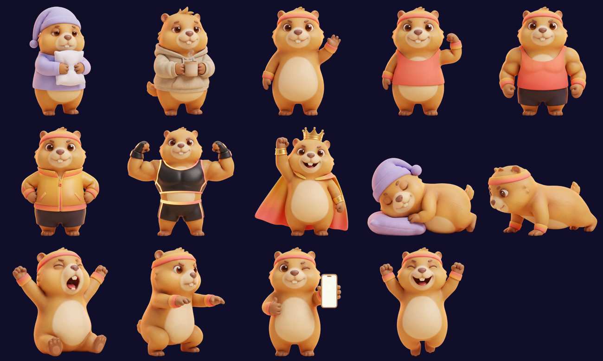
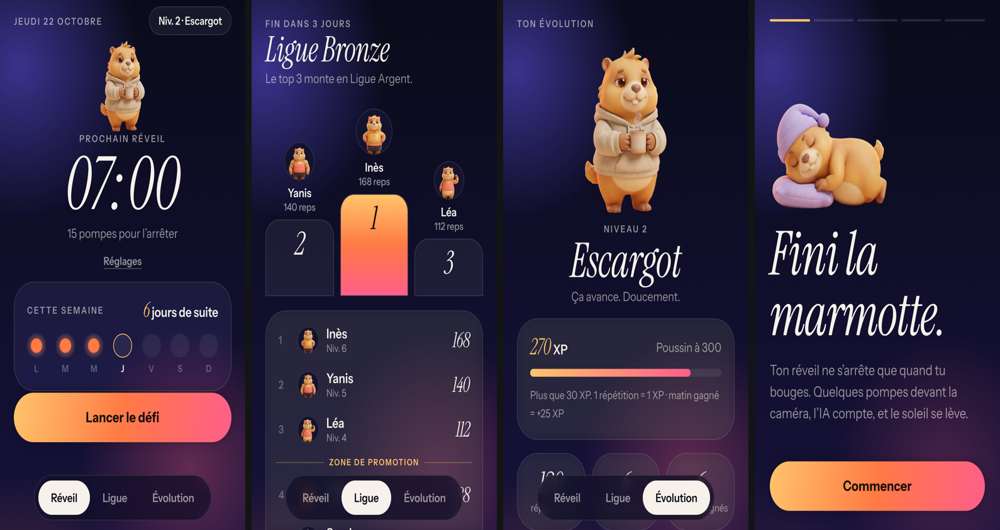
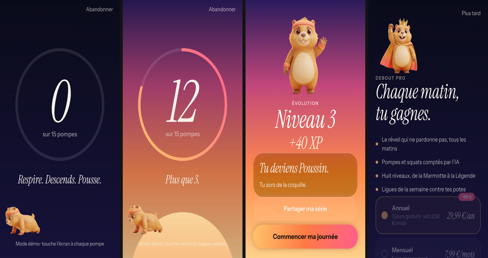

# Étape 13 — La mascotte : une marmotte qui se réveille

_Date : 22 octobre 2026_

Kenji a donné son feu vert pour la mascotte et choisi la **piste A** (3D « figurine » douce) plutôt que la
piste B (illustration 2D).

## Le personnage

Une marmotte (logique : « fini la marmotte ») ronde, fourrure miel, ventre crème, avec un **bandeau et
des poignets éponge aux couleurs de l'aube** (or → rose corail). Elle est originale, générée avec
Higgsfield (Nano Banana) à partir d'une planche de référence 4 vues : `design/marque/mascotte/turnaround-a.png`.

## Ce qui a été généré

- **8 niveaux d'évolution**, un par rang : Marmotte (pyjama, oreiller) → Escargot (sweat, café) → Poussin
  (bandeau) → Coq (débardeur, petit biceps) → Taureau (musclée) → Lion (veste dorée) → Machine (tenue
  futuriste lumineuse) → Légende (couronne, cape, aura dorée).
- **6 poses** pour les moments de l'app : elle dort, elle se réveille, elle fait des pompes, des squats, elle
  fête sa victoire, elle montre son téléphone.

Coût : 2 crédits par image (2 pistes + 14 images) + 14 détourages. Les fichiers sont dans
`design/marque/mascotte/detoure/` (1 200 px) et `app/assets/mascot/` (512 px, pour l'app).

## Où elle apparaît dans l'app

| Écran | Mascotte | Animation |
|---|---|---|
| Onboarding | elle dort sur son oreiller | respire |
| Accueil | ton niveau actuel | respire ; elle saute quand tu la touches |
| Défi | elle fait l'exercice avec toi (pompes ou squats) | elle saute à chaque répétition |
| Victoire | elle saute de joie… | rebondit en boucle |
| Passage de niveau | …ou apparaît à son nouveau niveau | flotte |
| Évolution | ton niveau en grand + l'échelle des 8 niveaux | les niveaux verrouillés sont des **silhouettes mystère « ??? »** |
| Ligue | l'avatar de chaque joueur = sa mascotte à son niveau | |
| Paywall | la Légende couronnée | flotte |

Composant : `app/src/components/mascot.tsx` (respiration, flottement, rebond, saut, silhouette).

Vidéos : [parcours complet](images/debout-demo.mp4) · [le défi seul](images/debout-defi.mp4)

## À améliorer

- **La pose « pompes » ressemble plus à « à quatre pattes »** qu'à une vraie pompe : à regénérer (2 crédits).
- Pour la ligue, les avatars sont petits : une version « tête seule » de chaque niveau serait plus lisible.
- **Dribbble** : toujours bloqué par son contrôle anti-robot (`awswaf.com`). Je n'ai pas pu regarder les
  animations des shots. Les animations de l'app viennent de mes connaissances des patterns courants (respiration,
  squash & stretch, cascade, compteur qui défile).
- La mascotte est générée par IA : vérifier les conditions d'utilisation commerciale de Higgsfield avant le lancement.
