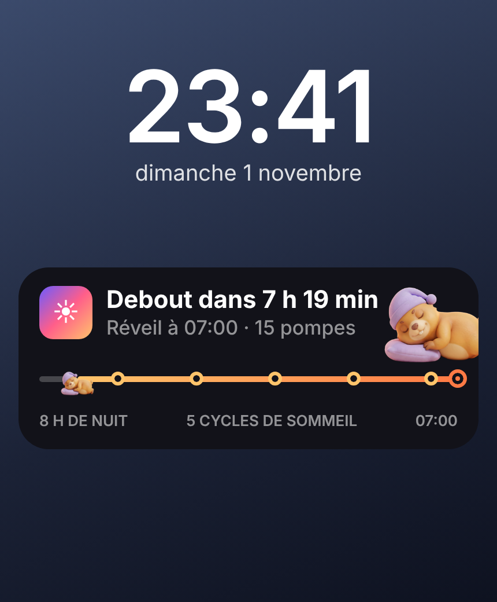

# La marmotte qui avance pendant la nuit + le rappel « réveil de demain » — code prêt

_Date : 1er novembre 2026_

Kenji n'aimait pas la première version de l'écran verrouillé (« on dirait pas Uber ») et veut que la marmotte
avance pendant la nuit, comme la voiture Uber. Il veut aussi une notification du soir « règle ton réveil ».

## Nouveau design de l'écran verrouillé (façon Uber)

- En haut : « DEBOUT » à gauche, ⏰ heure du réveil à droite.
- En très gros : le temps de sommeil restant (« 7 h 42 min »), « de sommeil avant ton défi ».
- Le **trajet de la nuit** : 🌙 → ☀︎, une barre qui se remplit toute seule, et **la marmotte qui avance** dessus.
- En bas : heure du coucher à gauche, le défi (« 15 pompes ») à droite.
- À l'heure du réveil : « Debout ! 15 pompes pour arrêter le réveil », marmotte réveillée, barre aux couleurs de l'aube.
- **Mise à jour du 01/11 d'après la référence Dribbble de Kenji** (« Live activity tracking », Maxim Podavalkin) :
  badge de l'app à gauche + titre en gras « Debout dans 7 h 42 min », sous-titre « Réveil à 07:00 · 15 pompes »,
  grosse marmotte qui déborde à droite (comme le bateau), ligne de la nuit grise derrière la marmotte et dorée
  devant, avec un arrêt à chaque **cycle de sommeil** (90 min) comme des stations, soleil au bout ; en bas
  « 8 H DE NUIT · 3 CYCLES DE SOMMEIL · 07:00 ».

## Comment la marmotte avance

Apple ne laisse bouger tout seuls que les comptes à rebours et la barre. Pour déplacer la marmotte, il faut lui
envoyer sa nouvelle position : c'est le rôle d'un petit programme sur notre serveur (Supabase).

1. « Bonne nuit 🌙 » : l'app lance l'activité et iOS lui donne un **jeton push** (l'adresse de cet écran verrouillé).
2. L'app enregistre ce jeton + l'heure du coucher et du réveil dans la table `sleep_activities` (Supabase).
3. Toutes les **10 minutes**, la fonction `sleep-tick` calcule où en est la nuit (0 → 100 %) et envoie la nouvelle
   position à chaque iPhone par le service de notifications d'Apple (APNs), en priorité basse (pas de limite).
4. Quand l'app s'ouvre pendant la nuit, elle remet aussi la marmotte à la bonne place.

Sans serveur, la marmotte attend au bout du trajet (au soleil) et seule la barre avance.

| Fichier | Rôle |
|---|---|
| `app/targets/sleep/SleepLiveActivity.swift` | Le nouveau design (écran verrouillé + Dynamic Island) |
| `app/modules/debout-alarm/ios/SleepActivity.swift` | Lance l'activité avec jeton push, met à jour la position |
| `app/src/lib/sleep.ts` | Envoie le jeton à Supabase, remet la marmotte en place à l'ouverture |
| `app/supabase/migrations/0002_sleep_activities.sql` | La table des nuits en cours (chacun ne voit que la sienne) |
| `app/supabase/functions/sleep-tick/index.ts` | Le programme serveur lancé toutes les 10 minutes |

## Notification du soir « réveil de demain »

Une heure avant l'heure du coucher : « Demain : réveil à 07:00 ⏰ · 15 pompes pour l'arrêter. Tout est bon ? ».
La toucher ouvre les réglages du réveil. Si le réveil est désactivé : « Pas de réveil prévu demain » à 21 h.
C'est une notification **locale** : pas besoin de serveur ni de clé de push.

## Ce que Kenji doit brancher (une fois)

1. **Créer le projet Supabase** (déjà dans la liste, `15-comptes-et-ligue.md`), puis coller aussi le fichier
   `0002_sleep_activities.sql` dans **SQL Editor** → **Run**.
2. **Nouvelle clé de push Apple** : developer.apple.com → Certificates, Identifiers & Profiles → **Keys** → **+** →
   cocher **Apple Push Notifications service (APNs)** → télécharger le `.p8` (une seule fois possible).
3. Supabase → **Edge Functions** → **Secrets** : ajouter `APNS_KEY_ID`, `APNS_TEAM_ID`, `APNS_BUNDLE_ID`
   (= `fr.debout.app`) et `APNS_PRIVATE_KEY` (le contenu du `.p8`). Jamais dans le chat.
4. Supabase → **Edge Functions** → **Deploy a new function** → nom `sleep-tick` → coller le code de
   `supabase/functions/sleep-tick/index.ts` → Deploy. (Ou Claude le fait, une fois l'accès Supabase autorisé.)
5. Supabase → **Integrations** → **Cron** → nouvelle tâche toutes les 10 minutes (`*/10 * * * *`) qui appelle la
   fonction `sleep-tick`.
6. Nouveau build (nouveau code natif).

## Non testé (🟡)

Rien de tout ça n'a tourné sur un iPhone : Swift du widget et du module jamais compilé, envoi APNs jamais essayé.
Le code serveur est vérifié par TypeScript seulement.
